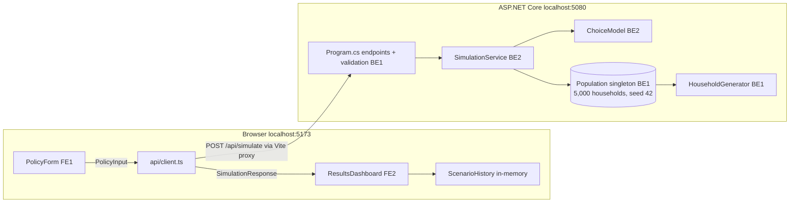

# PolicySim — Plan

> One-day hackathon MVP. 4 developers: BE1, BE2 (C#/.NET), FE1, FE2 (React/TypeScript).
> This plan is the **binding contract** for schemas and the API. Sections 6–8 are the pieces everyone must agree on before coding (target: first 45 minutes).
> It supersedes the open questions in `docs/frontend/API_DRAFT.md` and `docs/frontend/API_FUNCTIONS_DRAFT.md`. Section 9 explains what was kept from those drafts and what was cut.

---

## 1. Overview

PolicySim lets a legislator set three transportation policy levers (gas tax change — raise or cut, EV rebate, public transit fare) and see how 5,000 synthetic households might respond: keep driving gas, switch to an EV, or move partly or fully to public transit. It shows how many households switch, how their yearly transportation costs change, and how CO2 emissions change. All results are compared with a "current law" baseline. It is an **exploratory, rule-based simulation, not a forecast**, and the UI must say so.

---

## 2. Assumptions & Open Questions

### Assumptions (decided here; change only by agreement of all four devs)
- **A-1 Gas tax is a signed *change*** to today's pump price (`BASE_GAS_PRICE = $3.50/gal`, existing taxes included). The brief's "$1.00 per gallon" means +$1.00/gal. **Cuts are allowed** (decided 2026-11-14) down to **−$0.50/gal**, which is roughly the full combined federal + average state gas tax already in the $3.50 base, so the minimum models a full repeal (pump price $3.00). Going lower would be a fuel subsidy, which is out of scope.
- **A-2 Each household gets exactly one primary mode** per scenario: `gas`, `ev`, `partialTransit` (keeps the gas car and shifts 40% of miles to transit), or `fullTransit` (car-free). Categories do not overlap, so counts always add up to 5,000.
- **A-3 Baseline ("before") = the same model run with the status-quo policy** (`+$0.00` tax, `$0` rebate, `$2.50` fare) on the same population. "After" = the model run with the user's policy. Because both runs use identical households and rules, the status-quo policy gives **zero change**. That property is tested (see §12).
- **A-4 Fixed population.** 5,000 households are generated once at server startup with seed `42`. Every request reuses that population, which is what makes scenarios comparable. The request has no seed.
- **A-5 The decision rule is deterministic.** Randomness exists only in household generation. The same policy always gives the same result.
- **A-6 Steady-state interpretation.** The model answers "which option would each household choose at these prices?", not "what happens next month". The EV rebate is spread over the EV's assumed life (8 years) as a yearly cost reduction.
- **A-7 No database, no authentication, no persistence.** Data is synthetic and contains no personally identifiable information (PII). Scenario history lives in browser memory only.
- **A-8 Local demo.** The app runs on localhost (backend `http://localhost:5080`, frontend `http://localhost:5173`). It is not deployed.

### Open questions (recommended answer in brackets; confirm at kickoff)
- ~~OQ-1: Allow a gas tax cut?~~ **Decided: yes.** Range −0.50 to +3.00 (A-1, §6.2).
- ~~OQ-2: .NET SDK version.~~ **Decided: .NET 10** (LTS). `global.json` pins a 10.0.x SDK with `rollForward: latestFeature`. All projects target `net10.0`.
- OQ-3: TypeScript or plain JavaScript on the frontend? [TypeScript. The contract types in §6 can be pasted in directly.]
- OQ-4: Do we need a hosted URL for judging? *(Team deciding.)* [Recommended: no, demo from a laptop. If a hosted URL is required, it must use HTTPS, and the CORS allowlist must change to the hosted origin.]
- OQ-5: Delete the empty `backend/Compute.cs`? *(Team deciding.)* [Recommended: yes, when BE1 scaffolds; see §5.]

---

## 3. Requirements

### Functional
- [ ] FR-1: Generate (or load) 5,000 synthetic households deterministically.
- [ ] FR-2: The user sets the gas tax change (increase or cut), EV rebate, and transit fare, with validation and sensible defaults.
- [ ] FR-3: Run the simulation and get baseline vs. policy results in a single request.
- [ ] FR-4: Show mode counts before and after (gas / EV / partial transit / full transit) and the number of households that switched.
- [ ] FR-5: Show the average yearly household cost change in $ and %. *(The by-income-band breakdown is CUT-FIRST.)*
- [ ] FR-6: Show the total yearly CO2 emissions change (tonnes and %) and per household.
- [ ] FR-7: Compare scenarios: keep a history of runs in the session and show them side by side in a comparison table. This is how the plan meets brief success criterion #6.
- [ ] FR-10 *(CUT-FIRST)*: Extras: `byIncomeBand` chart, `transitions` ("who switched from what to what"), and `GET /api/config`. The form falls back to hardcoded ranges.

> **CUT-FIRST rule:** if Checkpoint 2 (T+4:15) is behind schedule, the items tagged CUT-FIRST are dropped from the UI and from Definition of Done. The backend fields can stay in the response, since they are cheap and the contract does not change. Nothing tagged CUT-FIRST may block the demo.
- [ ] FR-8: Explain the model in plain language, with an "exploratory estimates" disclaimer and a "How this works" panel.
- [ ] FR-9: Show loading, error, and success states. Out-of-range input is rejected on both the client and the server.

### Non-functional
- [ ] NFR-1: Simulation response in under 200 ms locally (5,000 households × 4 options is microseconds of math).
- [ ] NFR-2: Reproducible: identical policy input gives byte-identical numeric results.
- [ ] NFR-3: Security at hackathon scale: server-side input validation, no secrets anywhere, CORS limited to the dev origin, no stack traces in responses (see §15.2).
- [ ] NFR-4: Understandable to a non-technical user. It passes when all of these hold:
  - (a) No internal field name (`partialTransit`, `baseline`, `evAffinity`, camelCase, etc.) appears anywhere in the UI. Modes use the plain names in §6.0.
  - (b) Every displayed number carries a unit ($, $/yr, %, t CO2/yr, households).
  - (c) The plain-language summary sentence is shown for every result.
  - (d) Every card and chart title carries an "Estimate" tag.
  - (e) Colors come from one named palette (Okabe-Ito, fixed mode → color mapping), and every color is paired with a text label, so meaning never depends on color alone.
- [ ] NFR-5: Basic accessibility:
  - Labeled inputs, keyboard-usable controls, touch targets of at least 44 px.
  - Sliders have `aria-valuetext` that includes the unit.
  - Error text is linked by `aria-describedby` and says what to do.
  - Every chart has an `aria-label`/caption and a table alternative (see §10.4).

---

## 4. Architecture

**Pattern:** a two-tier app. A React single-page app calls a stateless ASP.NET Core Minimal API. The backend is split into *Domain* (pure C#, no HTTP: household generator, choice model, aggregator) and *Api* (endpoints, DTOs, validation). Domain code is unit-testable without a web host, so BE1 and BE2 can work in separate files with no shared mutable state.



**Request flow:** validate input → for each household, run `ChoiceModel.Evaluate(household, statusQuo)` (baseline outcomes are cached at startup) and `ChoiceModel.Evaluate(household, policy)` → aggregate → JSON.

### Tech stack
| Choice | Reason |
|---|---|
| **C# / ASP.NET Core Minimal API** (.NET 10 LTS, `net10.0`, SDK pinned in `global.json`) | The team already chose C# (`backend/Compute.cs`). Minimal API gives about 30 lines of wiring, built-in JSON camelCase, and built-in `ValidationProblem`. |
| **xUnit** test project | Default .NET test framework, zero setup through `dotnet new xunit`. |
| **In-memory singleton population** | No database is needed. 5,000 records is about 500 KB. Startup generation takes milliseconds. |
| **React + TypeScript + Vite** | Fastest SPA scaffold. TypeScript catches contract drift. Vite's dev proxy removes CORS friction. |
| **Recharts** (MIT) | Declarative bar and pie charts in React with no D3 knowledge. Covers every chart we need. |
| **Plain CSS / CSS modules** | No UI kit to learn on the day. Optional: a classless baseline stylesheet (e.g. Pico CSS) if FE1/FE2 agree. |
| **No state library** | `useState` in `App.tsx` is enough: current result, history array, loading/error. |

---

## 5. Folder & File Structure

`backend/Compute.cs` is empty. **Delete it** when BE1 scaffolds the solution. Its role is split into `ChoiceModel.cs` and `SimulationService.cs`.

```
policysim/
├── global.json                         # pins .NET SDK version (BE1)
├── README.md                           # how to run backend + frontend (BE1 + FE1, at polish)
├── backend/
│   ├── PolicySim.sln                   # solution (BE1)
│   ├── PolicySim.Api/
│   │   ├── PolicySim.Api.csproj
│   │   ├── Program.cs                  # host, CORS, JSON options, manual body read, endpoint mapping, error handler (BE1)
│   │   ├── Properties/launchSettings.json # single HTTP-only profile on http://localhost:5080 (BE1)
│   │   ├── Contracts/                  # wire DTOs — the C# mirror of §6 (BE2 owns, BE1 reviews)
│   │   │   ├── PolicyInput.cs          # request DTO (nullable fields, see §6.2)
│   │   │   ├── SimulationResponse.cs   # response DTOs (ScenarioSummary, ModeCounts, etc.)
│   │   │   └── ConfigResponse.cs       # GET /api/config DTO
│   │   ├── Validation/
│   │   │   └── PolicyInputValidator.cs # PolicyInput → (Policy | errors dictionary) (BE1)
│   │   └── Domain/
│   │       ├── Policy.cs               # validated, non-null domain policy record (BE2)
│   │       ├── Household.cs            # household record + enums (BE1)
│   │       ├── HouseholdGenerator.cs   # seeded synthetic population (BE1)
│   │       ├── GeneratorSettings.cs    # distribution parameters (BE1)
│   │       ├── Population.cs           # singleton: households + cached baseline outcomes (BE1)
│   │       ├── TransportMode.cs        # enum Gas, Ev, PartialTransit, FullTransit (BE2)
│   │       ├── ModelConstants.cs       # every constant in §7.4 in one place (BE2)
│   │       ├── ChoiceModel.cs          # per-household option costs, emissions, choice (BE2)
│   │       └── SimulationService.cs    # runs baseline vs policy, aggregates → SimulationResponse (BE2)
│   └── PolicySim.Tests/
│       ├── PolicySim.Tests.csproj
│       ├── HouseholdGeneratorTests.cs  # determinism, ranges, distribution sanity (BE1)
│       ├── ValidatorTests.cs           # range/finite/null unit tests on PolicyInputValidator (BE1)
│       ├── ApiTests.cs                 # WebApplicationFactory: malformed/missing/unknown/string/content-type → 400 (BE1)
│       ├── ContractTests.cs            # live JSON key set + enum values == frontend mock (BE1, at Checkpoint 2)
│       ├── ChoiceModelTests.cs         # hand-computed households, one per mode (BE2)
│       └── SimulationServiceTests.cs   # fixed point, monotonicity, determinism, calibration (BE2)
├── frontend/
│   ├── package.json
│   ├── vite.config.ts                  # dev proxy /api → http://localhost:5080 (FE1)
│   ├── index.html
│   └── src/
│       ├── main.tsx
│       ├── App.tsx                     # layout; owns state: lastResult, history, status (FE1)
│       ├── api/
│       │   ├── types.ts                # TS mirror of §6 incl. ScenarioRun, IncomeBand, RunStatus — the ONLY place types live (FE1 owns, FE2 reviews)
│       │   └── client.ts               # getConfig(), runSimulation() (FE1)
│       ├── mocks/
│       │   └── simulationResponse.ts   # §6.3 example as `export const mock = {...} satisfies SimulationResponse` (FE2)
│       ├── labels.ts                   # plain-language mode names + Okabe-Ito colors (§6.0) (FE2)
│       ├── components/
│       │   ├── policy/                 # FE1
│       │   │   ├── PolicyForm.tsx      # 3 inputs + Run button + states
│       │   │   ├── PolicyField.tsx     # slider + number input + unit + error text
│       │   │   └── PresetButtons.tsx   # "Current law", demo scenarios A/B/C
│       │   └── results/                # FE2
│       │       ├── ResultsDashboard.tsx # composes everything below
│       │       ├── ResultsFor.tsx      # "Results for: <inputs>" + stale-input notice
│       │       ├── SummaryCards.tsx    # switched, cost change ($ and %), emissions change (total, %, per household)
│       │       ├── ModeShiftChart.tsx  # grouped bar: before vs after per mode + table alternative
│       │       ├── CostByIncomeChart.tsx # CUT-FIRST; build only after Checkpoint 2
│       │       ├── PlainLanguageSummary.tsx # generated sentences
│       │       ├── ScenarioComparison.tsx # table of history runs (FR-7)
│       │       └── HowItWorks.tsx      # assumptions + disclaimer
│       └── utils/
│           └── format.ts               # usd(), tonnes(), pct(), signed numbers
└── docs/
    ├── plan.md                         # this file
    └── frontend/API_DRAFT.md, API_FUNCTIONS_DRAFT.md  # retained for reference; superseded by §6–§9
```

**Naming:** C# uses PascalCase files, types, and members, plus a `Usd`/`Kg`/`Tonnes` unit suffix on numeric members. JSON and TS use camelCase with the same unit suffixes. React components are PascalCase `.tsx`, and other TS files are camelCase `.ts`. Avoid vague names (`data`, `info`, `helper`, `Compute`).

---

## 6. Data Model & Contracts (binding)

Units: money is USD. Costs are **per household per year** unless the name says otherwise. Emissions are **metric tonnes CO2 per year for the whole population** in summaries, and kg in per-household internals. JSON uses camelCase. Mode enum strings on the wire are `"gas" | "ev" | "partialTransit" | "fullTransit"`.

### 6.0 UI display names and colors (`frontend/src/labels.ts`; the only strings the UI shows for modes)
| Wire value | UI label (everywhere: cards, charts, tables, sentences) | Okabe-Ito color |
|---|---|---|
| `gas` | Drives gas car | vermillion `#D55E00` |
| `ev` | Drives EV | bluish green `#009E73` |
| `partialTransit` | Drives less + rides transit | sky blue `#56B4E9` |
| `fullTransit` | No car, transit only | blue `#0072B2` |
| baseline / proposed | "Current law" / "Your policy" | grey `#999999` / orange `#E69F00` where a 2-series color is needed |

### 6.1 Household schema (internal to backend; exposed only by the stretch sample endpoint)

| Field | Type | Range / values | Generation rule (seeded `System.Random(42)`) |
|---|---|---|---|
| `id` | int | 1–5000 | sequential |
| `incomeUsd` | int | 15,000–300,000 | log-normal, median 70,000 (`exp(N(ln 70000, 0.6))`), clamped |
| `incomeBand` | enum | `low` (<50k), `middle` (50k–<120k), `high` (≥120k) | derived from income |
| `annualMiles` | int | 2,000–30,000 | normal(12,000, 4,000), clamped |
| `vehicleMpg` | double | 15–45 | normal(26, 6), clamped, rounded to 0.1 |
| `transportBudgetUsd` | int | ≥ 1,000 | `incomeUsd × U(0.10, 0.18)` — yearly amount the household is comfortable spending on transport |
| `evAffinity` | double | 0–1 | `u²` with `u ~ U(0,1)` (skewed low, mean ≈ 0.33). This is the brief's "likelihood of purchasing an EV". |
| `transitAccess` | enum | `none` 45% / `limited` 30% / `good` 25% | categorical draw |
| `transitHassleUsd` | int | 500–8,000 | `U(500, 8000)`. Yearly dollar-equivalent inconvenience of going car-free. |

```csharp
public enum IncomeBand { Low, Middle, High }
public enum TransitAccess { None, Limited, Good }
public sealed record Household(
    int Id, int IncomeUsd, IncomeBand IncomeBand, int AnnualMiles, double VehicleMpg,
    int TransportBudgetUsd, double EvAffinity, TransitAccess TransitAccess, int TransitHassleUsd);
```
```ts
export type IncomeBand = "low" | "middle" | "high";
export type TransitAccess = "none" | "limited" | "good";
export interface Household {
  id: number; incomeUsd: number; incomeBand: IncomeBand; annualMiles: number; vehicleMpg: number;
  transportBudgetUsd: number; evAffinity: number; transitAccess: TransitAccess; transitHassleUsd: number;
}
```
Example: `{"id":17,"incomeUsd":64200,"incomeBand":"middle","annualMiles":13850,"vehicleMpg":24.3,"transportBudgetUsd":8120,"evAffinity":0.41,"transitAccess":"limited","transitHassleUsd":3900}`

The households do **not** store a "current mode". The baseline mode is *computed* by the status-quo run (A-3).

**Generator rules** (needed for reproducibility):
- Signature: `HouseholdGenerator.Generate(int count, int seed)`, so the seed is a parameter.
- Use one `new Random(seed)` instance, drawn in a fixed field order. Never use `Random.Shared` or a `new Random()` without a seed.
- Normal draws use Box-Muller with `u1 = 1.0 - rng.NextDouble()`, which avoids `log(0)`.
- **The `Household` shape is frozen at T+0:15** so BE2 can write hand-built test households against it.

### 6.2 Policy input schema (request body of `POST /api/simulate`)

| Field | Type | Min | Max | Step (UI) | Default | Status quo | Unit |
|---|---|---|---|---|---|---|---|
| `gasTaxChangeUsdPerGallon` | number | −0.50 | 3.00 | 0.05 | 0.00 | 0.00 | USD per gallon, signed, added to $3.50 base (negative = tax cut; pump price stays ≥ $3.00) |
| `evRebateUsd` | number | 0 | 12,000 | 250 | 0 | 0 | USD, one-time per EV bought. Max = `EV_PRICE_PREMIUM`, since a larger rebate would have no effect in the model. |
| `publicTransitFareUsdPerRide` | number | 0.00 | 10.00 | 0.25 | 2.50 | 2.50 | USD per ride |

All three fields are **required** and must be JSON numbers that are finite and within the range (inclusive). Unknown fields are rejected, and so are numbers sent as strings (`"1.0"`). No seed and no household count go in the request (see §9).

**Two types: a wire DTO and a domain record (BE1/BE2 kickoff decision #14).**
```csharp
// Contracts/PolicyInput.cs — wire DTO. Fields are nullable so a MISSING field is detectable (null),
// not silently 0. Do NOT use `required`: in Minimal APIs its failure becomes a bare BadHttpRequestException,
// not a field-keyed 400.
[JsonUnmappedMemberHandling(JsonUnmappedMemberHandling.Disallow)]
public sealed record PolicyInput(
    double? GasTaxChangeUsdPerGallon, double? EvRebateUsd, double? PublicTransitFareUsdPerRide);

// Domain/Policy.cs — produced only by the validator; everything in Domain/ takes this, never the DTO.
public sealed record Policy(double GasTaxChangeUsdPerGallon, double EvRebateUsd, double PublicTransitFareUsdPerRide);
```

**Validator** (`PolicyInputValidator.Validate(PolicyInput) → (Policy? policy, Dictionary<string,string[]> errors)`). For each field:
- `null` → `"Required."`
- otherwise reject unless `double.IsFinite(x) && x >= min && x <= max`. The message says what to do, e.g. `"Enter a value from 0 to 12000."`.

> System.Text.Json does **not** reject huge numbers: `1e400` deserializes to `+∞`. The `double.IsFinite` check is mandatory.

**Body reading in `/api/simulate`.** Do not use automatic parameter binding: its errors are not field-keyed. Instead:
```
if (!request.HasJsonContentType())        → 400 ValidationProblem { "body": ["Send a JSON body with Content-Type: application/json."] }
try { dto = await request.ReadFromJsonAsync<PolicyInput>(jsonOptions) }
catch (JsonException ex)                  → 400 ValidationProblem { key: ex.Path "$.evRebateUsd" → "evRebateUsd"; "$" or null → "body" }
dto is null                               → 400 { "body": ["Request body is required."] }
validator errors                          → 400 ValidationProblem(errors)
else                                      → 200 SimulationService.Run(policy)
```
This returns **400, not 415**, for a missing Content-Type, so the client only has to handle one error shape.

**JSON options** (`ConfigureHttpJsonOptions`, also passed to `ReadFromJsonAsync`):
- `NumberHandling = JsonNumberHandling.Strict`. The Web defaults accept `"1.0"` as a string.
- Add `JsonStringEnumConverter(JsonNamingPolicy.CamelCase)`.
- Keep camelCase property naming (the default).
- Also register `AddProblemDetails()` + `UseExceptionHandler()`.

```ts
export interface PolicyInput {
  gasTaxChangeUsdPerGallon: number;
  evRebateUsd: number;
  publicTransitFareUsdPerRide: number;
}
```
```json
{ "gasTaxChangeUsdPerGallon": 1.00, "evRebateUsd": 7500, "publicTransitFareUsdPerRide": 2.50 }
```

### 6.3 Simulation output schema (response of `POST /api/simulate`)

```ts
export type TransportMode = "gas" | "ev" | "partialTransit" | "fullTransit";

export interface ModeCounts { gas: number; ev: number; partialTransit: number; fullTransit: number } // sums to householdCount

export interface ScenarioSummary {
  modeCounts: ModeCounts;
  avgAnnualCostUsd: number;                 // mean out-of-pocket transport cost per household per year
  totalEmissionsTonnesCo2PerYear: number;   // whole population
  emissionsPerHouseholdTonnesCo2PerYear: number; // total / householdCount, 2 decimals
}

export interface Transition { from: TransportMode; to: TransportMode; count: number } // only from != to, count > 0

export interface IncomeBandResult {
  incomeBand: IncomeBand;
  householdCount: number;
  baselineModeCounts: ModeCounts;
  policyModeCounts: ModeCounts;
  avgAnnualCostChangeUsd: number;           // mean(policy cost − baseline cost) within band
}

export interface SimulationResponse {
  modelVersion: string;                     // "0.1.0"; bump whenever ModelConstants or rules change
  householdCount: number;                   // 5000
  policy: PolicyInput;                      // echo of applied input
  statusQuoPolicy: PolicyInput;             // what "baseline" means
  baseline: ScenarioSummary;                // "before" (current law)
  proposed: ScenarioSummary;                // "after" (user policy)
  changes: {
    householdsSwitched: number;             // households whose mode differs from baseline
    householdsSwitchedPercent: number;      // 0–100, 1 decimal
    avgAnnualCostChangeUsd: number;         // proposed.avgAnnualCostUsd − baseline.avgAnnualCostUsd (can be negative)
    emissionsChangeTonnesCo2PerYear: number;// proposed − baseline (negative = reduction)
    emissionsChangePercent: number;         // relative to baseline, 1 decimal
  };
  transitions: Transition[];                // "who switched from what to what"
  byIncomeBand: IncomeBandResult[];         // 3 entries, order low, middle, high (CUT-FIRST: may be [] — UI must hide the section)
  assumptions: string[];                    // plain-language bullets for HowItWorks
}
```

C# mirror (`Contracts/SimulationResponse.cs`). Serialize enums as camelCase strings with `JsonStringEnumConverter(JsonNamingPolicy.CamelCase)`:
```csharp
public sealed record ModeCounts(int Gas, int Ev, int PartialTransit, int FullTransit);
public sealed record ScenarioSummary(ModeCounts ModeCounts, double AvgAnnualCostUsd, double TotalEmissionsTonnesCo2PerYear,
    double EmissionsPerHouseholdTonnesCo2PerYear);
public sealed record Transition(TransportMode From, TransportMode To, int Count);
public sealed record IncomeBandResult(IncomeBand IncomeBand, int HouseholdCount, ModeCounts BaselineModeCounts,
    ModeCounts PolicyModeCounts, double AvgAnnualCostChangeUsd);
public sealed record Changes(int HouseholdsSwitched, double HouseholdsSwitchedPercent, double AvgAnnualCostChangeUsd,
    double EmissionsChangeTonnesCo2PerYear, double EmissionsChangePercent);
public sealed record SimulationResponse(string ModelVersion, int HouseholdCount, PolicyInput Policy, PolicyInput StatusQuoPolicy,
    ScenarioSummary Baseline, ScenarioSummary Proposed, Changes Changes, IReadOnlyList<Transition> Transitions,
    IReadOnlyList<IncomeBandResult> ByIncomeBand, IReadOnlyList<string> Assumptions);
```
Add `emissionsPerHouseholdTonnesCo2PerYear` to `ScenarioSummary` (= total / householdCount) so the UI can show a relatable per-household figure.

Rounding:
- USD to 2 decimals, tonnes to 1 decimal (per-household tonnes to 2), percentages to 1 decimal.
- Use `Math.Round(x, d, MidpointRounding.AwayFromZero)`, then normalize `-0` to `0`, so a zero change never displays as "−0".
- Round **only in the DTO mapping**, never inside the model.
- **Empty-group guard:** any mean over an empty set (e.g. an income band with 0 households) returns 0, never NaN. A NaN makes the serializer throw, which surfaces as a 500. The same applies to `emissionsChangePercent` when the baseline is 0.
- Aggregation is a plain sequential loop. No `Parallel`/PLINQ, so the output is order-stable and byte-identical between runs.

**Canonical example.** This JSON is the content of the frontend mock `frontend/src/mocks/simulationResponse.ts`, written as `export const mockResponse = { ... } satisfies SimulationResponse;`. Do not import it as a `.json` file: TypeScript widens `"gas"` to `string`, and then the mock no longer satisfies the type. BE1 also saves the same JSON as `backend/PolicySim.Api/Stub/simulationResponse.sample.json`; it is the Checkpoint 0 stub response and the contract test's reference. The numbers are illustrative and internally consistent, not calibrated.
```json
{
  "modelVersion": "0.1.0",
  "householdCount": 5000,
  "policy": { "gasTaxChangeUsdPerGallon": 1.0, "evRebateUsd": 7500, "publicTransitFareUsdPerRide": 2.5 },
  "statusQuoPolicy": { "gasTaxChangeUsdPerGallon": 0.0, "evRebateUsd": 0, "publicTransitFareUsdPerRide": 2.5 },
  "baseline": {
    "modeCounts": { "gas": 4210, "ev": 230, "partialTransit": 260, "fullTransit": 300 },
    "avgAnnualCostUsd": 6850.00,
    "totalEmissionsTonnesCo2PerYear": 21500.0,
    "emissionsPerHouseholdTonnesCo2PerYear": 4.30
  },
  "proposed": {
    "modeCounts": { "gas": 3720, "ev": 520, "partialTransit": 430, "fullTransit": 330 },
    "avgAnnualCostUsd": 7120.56,
    "totalEmissionsTonnesCo2PerYear": 19870.5,
    "emissionsPerHouseholdTonnesCo2PerYear": 3.97
  },
  "changes": {
    "householdsSwitched": 490,
    "householdsSwitchedPercent": 9.8,
    "avgAnnualCostChangeUsd": 270.56,
    "emissionsChangeTonnesCo2PerYear": -1629.5,
    "emissionsChangePercent": -7.6
  },
  "transitions": [
    { "from": "gas", "to": "ev", "count": 290 },
    { "from": "gas", "to": "partialTransit", "count": 170 },
    { "from": "gas", "to": "fullTransit", "count": 30 }
  ],
  "byIncomeBand": [
    { "incomeBand": "low", "householdCount": 1600,
      "baselineModeCounts": { "gas": 1290, "ev": 0, "partialTransit": 130, "fullTransit": 180 },
      "policyModeCounts":   { "gas": 1160, "ev": 40, "partialTransit": 210, "fullTransit": 190 },
      "avgAnnualCostChangeUsd": 310.25 },
    { "incomeBand": "middle", "householdCount": 2500,
      "baselineModeCounts": { "gas": 2190, "ev": 90, "partialTransit": 110, "fullTransit": 110 },
      "policyModeCounts":   { "gas": 1950, "ev": 250, "partialTransit": 190, "fullTransit": 110 },
      "avgAnnualCostChangeUsd": 280.10 },
    { "incomeBand": "high", "householdCount": 900,
      "baselineModeCounts": { "gas": 730, "ev": 140, "partialTransit": 20, "fullTransit": 10 },
      "policyModeCounts":   { "gas": 610, "ev": 230, "partialTransit": 30, "fullTransit": 30 },
      "avgAnnualCostChangeUsd": 173.50 }
  ],
  "assumptions": [
    "Results are exploratory estimates from a simplified rule-based model, not predictions.",
    "5,000 synthetic households are generated from a fixed random seed; no real people are represented.",
    "Each household picks the transport option with the lowest yearly cost, including a personal 'hassle cost' for changing habits.",
    "Gas tax is added to a $3.50/gallon base price. EV rebates are spread over an 8-year vehicle life.",
    "Rebates are capped at $12,000, the assumed extra cost of an EV; a larger rebate would not change choices in this model.",
    "Government budget effects (gas tax revenue, rebate spending) are not included.",
    "Baseline means current law: no gas tax change, no EV rebate, $2.50 transit fare."
  ]
}
```

### 6.4 Config schema (`GET /api/config`)
```ts
export interface InputRule { min: number; max: number; step: number; defaultValue: number; unit: string; label: string }
export interface ConfigResponse {
  modelVersion: string;
  householdCount: number;
  populationSeed: number;
  statusQuoPolicy: PolicyInput;
  inputs: { gasTaxChangeUsdPerGallon: InputRule; evRebateUsd: InputRule; publicTransitFareUsdPerRide: InputRule };
  assumptions: string[];
}
```
The values come from the same C# constants the validator uses, so this is the single source of truth. **FE1 also hardcodes the §6.2 table as a fallback** so the form works before the endpoint exists.

### 6.5 Error schema
Only `400` and `500` are produced deliberately.
```json
{ "type": "https://tools.ietf.org/html/rfc9110#section-15.5.1", "title": "One or more validation errors occurred.",
  "status": 400, "errors": { "evRebateUsd": ["Enter a value from 0 to 12000."] } }
```
`errors` keys are either one of the three camelCase field names, which FE1 shows under that field, or `"body"`, which is a general form-level error. A `500` returns a generic ProblemDetails body with no exception text. Clients must still handle any non-2xx response whose body is not JSON, such as an HTML page from a dev server or an empty body.

---

## 7. Simulation Model (BE2 owns; BE1 co-owns calibration)

### 7.1 Idea in one sentence (use it in the UI)
> Each household compares the yearly cost of four options (keep the gas car, buy an EV, use transit for some trips, go car-free) and picks the cheapest. "Cost" includes real money plus a personal hassle cost for changing habits, and options that would blow the household's transport budget get an extra penalty.

This implements the brief's three example rules directly:
- "Gas costs exceed budget → more likely to switch" is the **budget stress penalty**.
- "Rebate brings EV under affordability threshold → more likely EV" is the **EV affordability gate** plus the lower amortized premium.
- "Transit affordable and available → more likely transit" is the **fare cost** plus the **access gate**.

### 7.2 Per-household formulas (policy `p`, household `h`)

```
gasPrice            = BASE_GAS_PRICE + p.gasTaxChangeUsdPerGallon
gasCostPerMile      = gasPrice / h.vehicleMpg + GAS_VEHICLE_COST_PER_MILE
evCostPerMile       = EV_KWH_PER_MILE * ELECTRICITY_PRICE + EV_VEHICLE_COST_PER_MILE
evNetPremium        = max(0, EV_PRICE_PREMIUM - p.evRebateUsd)
ridesFull           = h.annualMiles / TRANSIT_MILES_PER_RIDE
ridesPartial        = PARTIAL_SHARE * ridesFull

-- out-of-pocket yearly cost (what we REPORT as household cost)
cost[gas]            = VEHICLE_FIXED_COST + h.annualMiles * gasCostPerMile
cost[ev]             = VEHICLE_FIXED_COST + h.annualMiles * evCostPerMile + evNetPremium / EV_AMORTIZATION_YEARS
cost[partialTransit] = VEHICLE_FIXED_COST + (1 - PARTIAL_SHARE) * h.annualMiles * gasCostPerMile
                       + ridesPartial * p.publicTransitFareUsdPerRide
cost[fullTransit]    = ridesFull * p.publicTransitFareUsdPerRide

-- hassle (perceived, NOT reported as money spent)
hassle[gas]            = 0
hassle[ev]             = (1 - h.evAffinity) * EV_MAX_HESITANCY
hassle[partialTransit] = PARTIAL_HASSLE_FACTOR * h.transitHassleUsd
hassle[fullTransit]    = h.transitHassleUsd

-- availability gates
ev available             iff evNetPremium <= EV_UPFRONT_AFFORDABILITY_SHARE * h.incomeUsd
partialTransit available iff h.transitAccess in {limited, good}
fullTransit available    iff h.transitAccess == good
gas always available

-- budget stress
penalty[m]   = BUDGET_STRESS_MULTIPLIER * max(0, cost[m] - h.transportBudgetUsd)

perceived[m] = cost[m] + hassle[m] + penalty[m]
choice       = argmin over available m of perceived[m]
               ties broken in order gas, ev, partialTransit, fullTransit (prefer the status quo)
```

**Emissions (kg CO2 per year, per household):**
```
emis[gas]            = h.annualMiles / h.vehicleMpg * CO2_KG_PER_GALLON
emis[ev]             = h.annualMiles * EV_KWH_PER_MILE * GRID_CO2_KG_PER_KWH
emis[partialTransit] = (1 - PARTIAL_SHARE) * emis[gas] + PARTIAL_SHARE * h.annualMiles * TRANSIT_CO2_KG_PER_PASSENGER_MILE
emis[fullTransit]    = h.annualMiles * TRANSIT_CO2_KG_PER_PASSENGER_MILE
```

Suggested shape: `ChoiceModel.Evaluate(Household h, Policy p) → HouseholdOutcome(TransportMode Mode, double AnnualCostUsd, double AnnualEmissionsKg)`. It takes the validated domain `Policy`, not the wire DTO. The function is pure and static, with no I/O.

### 7.3 Aggregation (SimulationService)
- `baselineOutcomes` = `Evaluate(h, StatusQuo)` for all households, computed **once at startup** and cached in `Population`.
- `policyOutcomes` = `Evaluate(h, policy)` per request.
- `modeCounts` = count per mode. `avgAnnualCostUsd` = mean cost. `totalEmissionsTonnesCo2PerYear` = Σ emissions / 1000.
- `householdsSwitched` = count where `baseline.Mode != policy.Mode`, **in either direction**. A gas tax cut moves households *toward* gas (e.g. `partialTransit → gas`, `ev → gas`); that still counts as switching, and `transitions` shows the direction. `transitions` groups switchers by (from, to).
- `avgAnnualCostChangeUsd` = mean(policy cost − baseline cost). Use the same formula per income band.
- `emissionsChangePercent` = 100 × change / baseline total (the baseline is never 0 in practice; guard against it anyway).

### 7.4 Default constants (`ModelConstants.cs`)
| Constant | Default | Unit | Note |
|---|---|---|---|
| `BASE_GAS_PRICE` | 3.50 | USD/gal | current pump price, existing taxes included |
| `GAS_VEHICLE_COST_PER_MILE` | 0.10 | USD/mi | maintenance, tires, mileage depreciation |
| `EV_VEHICLE_COST_PER_MILE` | 0.06 | USD/mi | lower maintenance |
| `EV_KWH_PER_MILE` | 0.30 | kWh/mi | |
| `ELECTRICITY_PRICE` | 0.16 | USD/kWh | |
| `EV_PRICE_PREMIUM` | 12,000 | USD | extra cost of an EV vs. a comparable gas car |
| `EV_AMORTIZATION_YEARS` | 8 | years | premium (net of rebate) spread over vehicle life |
| `EV_UPFRONT_AFFORDABILITY_SHARE` | 0.20 | fraction of income | max net premium a household can pay up front. 0.10 failed calibration (EV 0.7%). |
| `EV_MAX_HESITANCY` | 4,000 | USD/yr | hassle at `evAffinity = 0` (range anxiety, charging access) |
| `VEHICLE_FIXED_COST` | 3,000 | USD/yr | insurance, registration, base depreciation; saved only by `fullTransit` |
| `TRANSIT_MILES_PER_RIDE` | 10 | mi/ride | |
| `PARTIAL_SHARE` | 0.40 | fraction of miles | share of miles moved to transit under `partialTransit` |
| `PARTIAL_HASSLE_FACTOR` | 0.25 | × `transitHassleUsd` | commute-only trips are the easy ones |
| `BUDGET_STRESS_MULTIPLIER` | 0.5 | × USD over budget | |
| `CO2_KG_PER_GALLON` | 8.887 | kg/gal | US EPA figure for gasoline |
| `GRID_CO2_KG_PER_KWH` | 0.37 | kg/kWh | approx. US grid average |
| `TRANSIT_CO2_KG_PER_PASSENGER_MILE` | 0.15 | kg/passenger-mi | approx. bus/rail blend |
| `STATUS_QUO` | {0.00, 0, 2.50} | — | baseline policy (A-3) |

**Sanity check on a median household** (12,000 mi, 26 mpg, $70k, `evAffinity` 0.5). The affordability limit is 0.20 × $70k = $14,000, so an EV is already within reach at current law ($12,000 premium).
- **Current law:** gas ≈ $3,000 + 12,000 × (3.50/26 + 0.10) ≈ **$5,820/yr**. EV ≈ $3,000 + 12,000 × 0.108 + $1,500 ≈ $5,800, plus $2,000 hesitancy ≈ $7,800 perceived. → **stays on gas**. At current law only households with very high affinity, high mileage, or low mpg pick an EV.
- **+$1 tax and $7,500 rebate:** gas ≈ $6,280. EV ≈ $4,860 + (1 − a) × $4,000. → switches when affinity a > ~0.64.
- For this household the rebate works through the **cheaper yearly premium**. The **affordability gate** matters for incomes below $60k: they cannot afford an EV at current law, and the $7,500 rebate lowers that cutoff to $22,500.

The model reacts in the expected direction, and the size of the reaction depends on the spread of household parameters.

**Verified by the backend reviewer** (actual .NET run of §6.1 + §7.2, seed 42, `EV_UPFRONT_AFFORDABILITY_SHARE = 0.20`):
- Current law: gas 89.0% / EV 2.5% / transit 8.5%, 3.99 t CO2 per household.
- Households switched: A (tax only) 6.2%, B (brief package) 23.9%, C (carrots only) 24.6%.
- Scenario A's switches split three ways: EV +59, partial transit +78, full transit +89.
- The current-law zero-change check and all monotonicity sweeps pass.

These are reference values. The demo numbers are whatever the team's build produces at Checkpoint 3.

### 7.5 Calibration targets (status quo, checked by a test)
| Metric | Target band |
|---|---|
| `gas` share | 75–90% |
| `ev` share | 2–8% |
| `partialTransit` + `fullTransit` share | 5–15% |
| Each demo preset A/B/C, households switched | 5–30% |
| Emissions per household (baseline mean) | 3–6 t/yr |

If the result falls outside a band, tune the knobs in this order: `EV_MAX_HESITANCY`, `transitHassleUsd` range, `PARTIAL_HASSLE_FACTOR`, `EV_UPFRONT_AFFORDABILITY_SHARE`. **Any change bumps `modelVersion`.** Calibration is time-boxed to 45 minutes. Plausible output is enough; the model does not need to be accurate.

**Gating:**
- The calibration test **does not block** anything before Checkpoint 2. Mark it `[Trait("Category","Calibration")]` so it can be excluded from early runs.
- After the 45-minute time box, a band that still misses is recorded in `README.md` under "Known deviations" with the actual value. It is not a Definition-of-Done blocker. The **fixed-point, monotonicity, conservation, and determinism tests always gate**.

### 7.6 Comparing scenarios (FR-7)
**The session history table is how this plan meets brief success criterion #6 ("Compare different policy scenarios").** The plain table is the floor. Comparison *charts* are a stretch goal.

Every response is "status quo vs. policy X" on the *same* population. That makes any two responses directly comparable: compare their `proposed` and `changes` blocks. The frontend keeps `history: ScenarioRun[]` in `App.tsx`. The cap is **6 runs**: adding a 7th drops the oldest. The type lives in `api/types.ts` only:
```ts
export interface ScenarioRun { id: number; label: string; policy: PolicyInput; result: SimulationResponse }
export type RunStatus = "idle" | "loading" | "success" | "error";
```
`ScenarioComparison` renders one column per run, with rows for:
- the 3 inputs
- households switched (n and %)
- EV and transit counts
- average cost change ($ and %)
- emissions change (t, %, per household)

Layout:
- Column headers are the policy inputs (e.g. "+$1.00/gal · $7,500 rebate · $2.50 fare"), with the preset name as a sub-label.
- "Current law" is always the first, fixed column.
- The table scrolls horizontally inside its own container, and the row-label column is frozen (`position: sticky`).
- The exploratory-estimate disclaimer appears directly above the table.

The comparison needs **no backend support**.

---

## 8. API Contract (binding)

| Method | Path | Request body | Success | Errors | Owner |
|---|---|---|---|---|---|
| GET | `/api/health` | — | 200 `{ "status": "ok" }` | — | BE1 |
| GET | `/api/config` *(CUT-FIRST)* | — | 200 `ConfigResponse` (§6.4) | 500 | BE1 |
| POST | `/api/simulate` | `PolicyInput` (§6.2) | 200 `SimulationResponse` (§6.3) | 400 (validation, malformed JSON, missing/unknown/string field, missing Content-Type), always field- or `body`-keyed per §6.2/§6.5; 500 generic | BE1 (endpoint + validation), BE2 (service) |
| GET | `/api/households/sample?count=20` *(stretch)* | — | 200 `Household[]`, `count` clamped to 1–100 | 400 | BE1 |

- JSON camelCase. `Content-Type: application/json`.
- **Dev wiring:**
  - `launchSettings.json` has a single **HTTP-only** profile, `applicationUrl: http://localhost:5080`.
  - **Do not call `UseHttpsRedirection()`**: a redirect to https breaks the Vite proxy.
  - Vite: `server: { proxy: { '/api': 'http://localhost:5080' } }`, with no path rewrite. The backend routes already start with `/api`.
- CORS: allow only the origin `http://localhost:5173` with methods `GET, POST` and header `Content-Type`. In development the Vite proxy makes calls same-origin, so CORS only matters if someone opens the API directly from another port.
- No authentication (A-7). This is recorded as an accepted decision (§15.2).

---

## 9. Reconciliation with `docs/frontend/API_DRAFT.md` and `API_FUNCTIONS_DRAFT.md`

The drafts are careful work and many of their rules are kept. Some parts are built for a production API and would cost hours on a one-day build with no demo benefit.

| Draft item | Decision | Why / simpler alternative |
|---|---|---|
| `/api` prefix, camelCase JSON, units in field names, DTOs separate from models | **Keep** | Cheap and prevents unit bugs. |
| `GET /api/health`, `GET /api/simulation/config` | **Keep**, config renamed to `/api/config` | Config provides a single source of truth for ranges. |
| `QUERY /api/simulation` (RFC 10008) | **Replace with `POST /api/simulate`** | QUERY is very new. Fetch accepts it, but it forces a CORS preflight, and Vite proxy, Swagger/OpenAPI tooling, curl habits and ASP.NET `MapMethods` all need special handling. It is a real integration risk that the demo gains nothing from. POST is fine for a side-effect-free computation here. |
| `seed` required in request | **Cut** (fixed server seed 42, exposed in config) | Comparisons need the *same* population. A user-chosen seed invites accidental cross-population comparisons. Stretch: optional `seed`. |
| `gasTaxUsdPerGallon` (total or increase undecided) | **Renamed `gasTaxChangeUsdPerGallon`** | Settles the ambiguity in the name itself (A-1). |
| `publicTransitFareUsdPerRide`, `evRebateUsd` | **Keep** names | |
| `BehaviorCount[]` arrays with string categories | **Replace with `ModeCounts` object** with 4 fixed keys | Modes are a closed set. An object is simpler to chart and type-checks fully. |
| `emissionsChange: {value, unit} \| null` | **Replace** with always-present `...TonnesCo2PerYear` fields | The unit goes in the name, and the value is never null. |
| Income-group results | **Keep** (`byIncomeBand`, 3 fixed bands) | Cheap, and it supports a strong equity talking point in the demo. |
| `assumptions[]`, `modelVersion` | **Keep** | Needed for FR-8 and for knowing which numbers came from which model. |
| `application/problem+json` errors | **Keep, but only 400 + 500** | ASP.NET's built-in `Results.ValidationProblem` / `UseExceptionHandler` provide this for free. |
| 17-row status table (401/403/405/406/408/409/413/415/422/429/501/502/503/504…) | **Cut** | There is no auth, no rate limiting, no proxy and no persistence, so none of these can occur by design. The client treats any non-2xx as "error". |
| `ApiResult<T>` union with 5 failure kinds, `RequestOptions`, timeouts | **Simplify** | `runSimulation()` returns the data or throws `ApiError {status, message, fieldErrors?, formError?}`. The UI has `idle → loading → success \| error`. The draft's rule "non-JSON error bodies still count as HTTP errors" is **kept** (§10.3). |
| AbortSignal cancellation, server `CancellationToken` in CPU loop, deadline tokens | **Cut** | The computation takes milliseconds. Disable the Run button while loading, **plus** a required latest-request-id guard: a response is ignored unless it belongs to the newest request. |
| Required members (draft C# used `required`) | **Replace** with `double?` fields + validator "Required." | In Minimal APIs, a `required` violation becomes a bare 400 with no field key (§6.2). |
| Retry / `Retry-After` / `Cache-Control` rules | **Cut** | Manual retry is the user clicking Run again. |
| Saved scenarios, pagination, household search endpoints | **Cut** | Comparison is done client-side (the draft recommended this too). |
| `decimal` for money inputs | **Use `double`** | Values are rounded at output, so `double` is fine. It avoids constant `(double)` casts in math. |
| "Keep side-by-side comparison in the frontend using two responses" | **Keep** | This is how FR-7 works (§7.6). |
| CORS allowlist, secrets backend-only, no stack traces | **Keep** | See §15.2. |

FE1 should add a one-line note at the top of both draft files: "Superseded for MVP by docs/plan.md §6–§9".

---

## 10. Workstreams

### 10.1 BE1 — Population & API host
1. **Objective:** Provide a deterministic, realistic-enough 5,000-household population and the HTTP shell (host, CORS, validation, config) that BE2's service plugs into.
2. **Responsibilities:**
   - Scaffold the solution and the test project.
   - Household record (shape frozen at T+0:15) and the seeded generator (rules in §6.1).
   - `Population` singleton with the cached baseline.
   - `Program.cs`: JSON options (Strict numbers, camelCase enum converter), `AddProblemDetails` + `UseExceptionHandler`, CORS, the HTTP-only profile, and the manual body read in §6.2.
   - `PolicyInputValidator` (DTO → domain `Policy`).
   - `/api/health`, `/api/config`.
   - Stub `/api/simulate` returning the §6.3 fixture until BE2's service lands.
   - Co-own calibration (§7.5).
   - Tests: generator, validator, API (WebApplicationFactory), and the contract test.
3. **Files:** `global.json`, `PolicySim.sln`, `Program.cs`, `launchSettings.json`, `Domain/Household.cs`, `HouseholdGenerator.cs`, `GeneratorSettings.cs`, `Population.cs`, `Validation/PolicyInputValidator.cs`, `Contracts/ConfigResponse.cs`, `Stub/simulationResponse.sample.json`, `Tests/HouseholdGeneratorTests.cs`, `Tests/ValidatorTests.cs`, `Tests/ApiTests.cs`, `Tests/ContractTests.cs`. Delete `backend/Compute.cs`.
4. **Interfaces:**
   - Provides `IReadOnlyList<Household> Population.Households` and `IReadOnlyList<HouseholdOutcome> Population.BaselineOutcomes`. The baseline is computed by calling BE2's `ChoiceModel.Evaluate`. Until it exists, use a stub that returns `Gas`.
   - Consumes `SimulationService.Run(Policy) → SimulationResponse` from BE2. The validator produces the `Policy`.
   - Provides the HTTP contract in §8 to FE1.
5. **Acceptance criteria:**
   - `dotnet run` serves on `http://localhost:5080` with no HTTPS redirect.
   - The generator gives 5,000 households, all fields in range, and the same output for seed 42 across runs.
   - These requests each return 400 with a field-keyed or `body`-keyed ValidationProblem, never a bare 400 or 415:
     - out of range
     - non-finite (`1e400`)
     - missing
     - `null`
     - number sent as a string
     - unknown field
     - malformed JSON
     - missing Content-Type
   - `/api/config` values match the §6.2 table.
   - CORS allows only `localhost:5173`.
   - Unhandled exceptions return a generic 500 with no stack trace.
6. **Order:**
   1. Scaffold the solution and stub `/api/simulate` with the fixture (Checkpoint 0). Freeze `Household` by T+0:15.
   2. `Household` + generator + tests.
   3. `Population` singleton.
   4. Body read + validator + tests.
   5. Config endpoint.
   6. Swap the stub for the real `SimulationService`.
   7. Contract test + calibration with BE2 (Checkpoint 2).
   8. Write the run instructions in `README.md`.
7. **Risks:**
   - .NET SDK mismatch across machines (mitigation: `global.json`).
   - Unrealistic distributions that break calibration.
   - `Program.cs` becomes a merge hotspot (BE1 is the only one who edits it).
8. **Minimal version:** Uniform distributions instead of log-normal/normal, health + simulate endpoints only, validation through a single range check.
9. **Stretch:**
   - `/api/households/sample`.
   - Optional `populationSize` (capped at 50,000) and `seed` query parameters.
   - Correlated attributes (e.g. high mileage less likely to have good transit access).
   - A `/api/debug/distribution` endpoint for calibration (dev only, removed before demo).

### 10.2 BE2 — Choice model & aggregation
1. **Objective:** Turn (household, policy) into a mode, cost, and emissions per household, and aggregate them into `SimulationResponse`.
2. **Responsibilities:**
   - `TransportMode`, `ModelConstants`, `Domain/Policy.cs`, `ChoiceModel.Evaluate`, `SimulationService.Run`.
   - The wire DTOs (`Contracts/PolicyInput.cs`, `SimulationResponse.cs`).
   - The assumptions text.
   - Rounding: AwayFromZero, normalize −0, and the empty-group guard.
   - Model tests: hand-computed cases, fixed point, monotonicity, conservation, determinism, calibration.
   - Owns the C# contract files: any change is announced to all four devs.
3. **Files:** `Domain/TransportMode.cs`, `Policy.cs`, `ModelConstants.cs`, `ChoiceModel.cs`, `SimulationService.cs`, `Contracts/PolicyInput.cs`, `Contracts/SimulationResponse.cs`, `Tests/ChoiceModelTests.cs`, `Tests/SimulationServiceTests.cs`.
4. **Interfaces:**
   - Consumes `Household` (BE1; frozen at T+0:15, so BE2 can write test households by hand immediately).
   - Provides `static HouseholdOutcome ChoiceModel.Evaluate(Household, Policy)` and `SimulationResponse SimulationService.Run(Policy)`. Domain code never sees the nullable DTO.
   - Provides the §6.3 JSON to FE2 through BE1's endpoint.
5. **Acceptance criteria:**
   - Hand-computed tests pass for at least one household per mode.
   - Status-quo policy gives `householdsSwitched == 0`, cost change 0, and emissions change 0, all serialized as `0`, never `-0`.
   - Monotonicity tests pass (§12).
   - `Run(policy)` twice serializes to byte-identical JSON.
   - Calibration bands (§7.5) pass, or the miss is recorded as a known deviation.
   - Mode counts sum to 5,000 overall and per band.
   - No NaN/∞ ever reaches the serializer.
   - The JSON shape matches the §6.3 fixture key for key (contract test).
   - A request takes under 200 ms.
6. **Order:**
   1. DTOs + constants (by Checkpoint 0, so BE1's stub compiles against them).
   2. `ChoiceModel` costs.
   3. Choice + gates.
   4. Emissions.
   5. Unit tests.
   6. `SimulationService` aggregation.
   7. Fixed-point and monotonicity tests.
   8. Integrate into the endpoint.
   9. Calibration.
   10. Assumptions text.
7. **Risks:**
   - The model is too strong or too weak (nobody switches, or everybody does). Mitigation: wide hassle distributions and the calibration knobs in §7.5.
   - Off-by-sign errors in "change" fields (always policy − baseline).
   - Partial transit never chosen. Check with a hand case: a low-mpg household with low hassle.
8. **Minimal version:**
   - Three modes: merge partial into full transit, then split later.
   - No budget penalty.
   - `byIncomeBand` and `transitions` (CUT-FIRST) can be returned as empty arrays, which is still contract-valid. They are filled in later by running the same aggregation code over a filtered list.
9. **Stretch:**
   - Fiscal block: `gasTaxRevenueUsdPerYear` and `rebateSpendingUsdPerYear`. This is an additive schema change, so announce it first.
   - Per-household drill-down endpoint.
   - A sensitivity sweep endpoint (e.g. switched count across gas tax −0.50 to +3.00) for a line chart.

### 10.3 FE1 — Policy input & app shell
1. **Objective:** A clear, validated form that runs simulations and holds app state, including the scenario history.
2. **Responsibilities:**
   - Scaffold Vite + React + TS and configure the proxy (§8).
   - Write `api/types.ts` (copied from §6, plus `ScenarioRun`, `RunStatus`, `IncomeBand`; the only definitions of these types).
   - Write `api/client.ts`.
   - Build `App.tsx` layout and state: `status`, `lastResult`, `lastRunPolicy`, `history`, latest-request-id ref.
   - Build `PolicyForm` / `PolicyField`: slider plus number box, unit label, inline error. The gas field is labeled "Gas tax change" with a signed value ("+$1.00/gal", "−$0.50/gal", "No change") and shows the resulting pump price ("Pump price: $4.50/gal"; at −$0.50, "Pump price: $3.00/gal"). The slider range is −0.50 to +3.00 with 0 marked as "current law", and the rebate is labeled "one-time, per EV bought".
   - Preset buttons, client-side validation, and loading/error/success states.
   - Push each successful run into `history` (cap 6).
   - Add the "Superseded" note to the draft docs.
3. **Files:** `vite.config.ts`, `App.tsx`, `api/types.ts`, `api/client.ts`, `components/policy/*`, `utils/format.ts` (shared with FE2; FE1 creates it).
4. **Interfaces:**
   - `client.ts` exports `getConfig(): Promise<ConfigResponse>` and `runSimulation(p: PolicyInput): Promise<SimulationResponse>`. On failure, `runSimulation` throws `ApiError { status: number; message: string; fieldErrors?: Record<string,string[]>; formError?: string }`. Mapping rules:
     - 400 with `errors` keys that match one of the three field names → `fieldErrors`.
     - Any other key (`"body"`, `"$"`, unknown) → joined into `formError`.
     - A non-2xx body that is not JSON (HTML, empty, plain text) → generic `message` built from the status. Never render the raw body.
     - A network failure → `status: 0`, message "Can't reach the simulator. Is the backend running?"
   - **Form state:** keep a **raw string per field** (`Record<FieldName, string>`) and parse it with `Number(s)` on change and before submit. Blank (`""`), non-numeric (`"abc"` → NaN), and a valid `0` are three distinct states. The slider sets the string; the number box edits the string.
   - **Double-click guard:** each submit increments `latestRequestId`. A response, or an error, updates state only if its id is still the latest. The Run button is also disabled while `status === "loading"`.
   - Renders `<ResultsDashboard status={status} result={lastResult} resultPolicy={lastRunPolicy} currentInputs={parsedInputsOrNull} history={history} />`. These are FE2's props, agreed at kickoff.
   - Presets:
     - Current law: {0, 0, 2.50}
     - A "Gas tax": {1.00, 0, 2.50}
     - B "Brief package": {1.00, 7500, 2.50}
     - C "Carrots only": {0, 7500, 1.00}
     - D "Gas tax cut": {−0.50, 0, 2.50}. This shows the lever working in reverse (households move toward gas and emissions rise).
5. **Acceptance criteria:**
   - Every input shows its unit and range. Sliders have `aria-valuetext` with the unit (e.g. "$1.00 per gallon"). Touch targets are at least 44 px.
   - Blank, non-numeric, and out-of-range input each show their own inline message that says what to do (e.g. "Enter an amount from $0 to $12,000."). The message is linked by `aria-describedby`, and Run is disabled. `0` is accepted as valid.
   - A server 400 with field keys appears under the matching field. A 400 with `body`, `$`, or unknown keys appears as a form-level error above the Run button. A non-JSON error body shows a generic message.
   - Run shows a spinner and is disabled while loading. Double-clicking produces at most one history entry, and a stale response never overwrites a newer one.
   - A network or 500 error shows a friendly message with a "Try again" option and keeps the inputs and the last result.
   - Presets fill the form.
   - Each successful run is added to the history with a label (the preset name or "Custom run N"). A 7th run drops the oldest.
   - Keyboard-only use works.
6. **Order:**
   1. Scaffold + proxy + `types.ts` (Checkpoint 0).
   2. Form with hardcoded ranges calling the stub.
   3. Validation + states.
   4. Presets.
   5. History state in App.
   6. Swap the hardcoded ranges for `getConfig()` (keep the fallback).
   7. Layout polish.
7. **Risks:**
   - Proxy misconfiguration: test `fetch('/api/health')` first.
   - Slider/number box sync bugs. Keep a single raw-string state per field and derive the number from it; never keep two sources of truth.
   - Floating-point display (`0.1 + 0.2`): format with `toFixed`.
8. **Minimal version:** Three `<input type="number">` with min/max/step, a Run button, and an error `<p>`.
9. **Stretch:**
   - Auto-run on preset click.
   - Encode the policy in the URL query string for shareable links.
   - Persist history to `localStorage` (wrapped in try/catch).

### 10.4 FE2 — Results dashboard & comparison
1. **Objective:** Make the results understandable at a glance to a non-technical legislator, and let them compare runs.
2. **Responsibilities:**
   - `ResultsDashboard`:
     - Empty state: "Run a simulation to see results".
     - While `status === "loading"`, the previous results stay visible but dimmed (`opacity: 0.5`, `aria-busy="true"`).
   - `ResultsFor`:
     - Shows "Results for: +$1.00/gal gas tax · $7,500 EV rebate · $2.50 fare" from `resultPolicy`.
     - When `currentInputs` differ from `resultPolicy`, it also shows "Inputs changed — click Run to update."
   - `SummaryCards`, each titled with an **"Estimate"** tag:
     - Households switched (n and %).
     - Average yearly cost change in signed $ **and %**. Compute the % as `changes.avgAnnualCostChangeUsd / baseline.avgAnnualCostUsd`.
     - Emissions change in tonnes and %, **plus per household** (current law vs. your policy, t CO2/yr). This card replaces a separate emissions chart.
   - `ModeShiftChart`:
     - Grouped bars, Current law vs. Your policy, for the 4 modes, using the §6.0 labels and colors.
     - Value labels on the bars, an `aria-label` / caption, and a "Show as table" toggle that renders the same numbers in a `<table>`.
   - `CostByIncomeChart` (**CUT-FIRST**; start only after Checkpoint 2 passes): same requirements as the mode chart (table alternative, value labels, Estimate tag). Hidden when `byIncomeBand` is empty.
   - `PlainLanguageSummary`: sentences generated from the response, using the §6.0 labels. For example: "Under this policy, 490 of 5,000 households (9.8%) change how they get around: 290 switch to driving an EV and 200 start using transit. Average yearly transport cost rises $271 (+3.9%); CO2 falls 7.6%." Shown for every result. When there is no change: "No households change behavior under this policy."
   - `ScenarioComparison` table (§7.6), with the disclaimer directly above it.
   - `HowItWorks`: disclaimer, the §7.1 sentence, `assumptions[]`, model version.
3. **Files:** `components/results/*`, `mocks/simulationResponse.ts`, `labels.ts`.
4. **Interfaces:**
   - Props `{ status: RunStatus; result: SimulationResponse | null; resultPolicy: PolicyInput | null; currentInputs: PolicyInput | null; history: ScenarioRun[] }`.
   - Imports all types from `api/types.ts` only and never redefines them (including `ScenarioRun` and `IncomeBand`).
   - Uses `utils/format.ts` and `labels.ts`.
5. **Acceptance criteria:**
   - The dashboard renders fully from the mock with no backend. The mock compiles with `satisfies SimulationResponse`.
   - The NFR-4 checks (a)–(e) pass: no internal names, units on every number, summary sentence shown, "Estimate" tag on every card and chart title, Okabe-Ito colors plus text labels.
   - Before/after is labeled "Current law" vs. "Your policy", never "baseline/proposed" in the UI.
   - The "Results for" line is always shown, and the stale-input notice appears whenever the form differs from the last run.
   - Every chart has a caption/`aria-label`, value labels, and a table alternative.
   - The comparison table shows at least 3 runs side by side, plus the current-law column. Headers show the policy inputs. On a narrow screen the table scrolls inside its own container with the label column frozen.
   - The disclaimer is visible without scrolling on the results view, and again above the comparison table.
   - It renders correctly when a mode count is 0, when `transitions` or `byIncomeBand` is empty, and for the status-quo run.
6. **Order:**
   1. Mock fixture (`.ts`) + `labels.ts` + `SummaryCards` (Checkpoint 0).
   2. `ResultsFor` + `ModeShiftChart` with table toggle.
   3. `PlainLanguageSummary`.
   4. `ScenarioComparison`, using a mock history of 2–3 copies with edited numbers.
   5. `HowItWorks`.
   6. Wire to real data, including loading dimming.
   7. Copy and label polish.
   8. Only after Checkpoint 2: `CostByIncomeChart`.
7. **Risks:**
   - Time lost to chart styling: use Recharts defaults first.
   - Misreading signs: a negative emissions change is *good*. Use the words "reduction"/"increase" instead of relying on color alone.
   - Too much on screen: cards first, charts second, table last.
8. **Minimal version:** Summary cards, the "Results for" line, one before/after bar chart with its table alternative, the comparison table as a plain `<table>` (the floor for success criterion #6), and a disclaimer paragraph.
9. **Stretch:**
   - Sankey or arrow diagram from `transitions`.
   - Charts comparing two selected runs (the comparison table is the MVP; comparison charts are stretch).
   - "Who pays" view per income band.
   - Download results as CSV.

---

## 11. One-Day Timeline & Integration Checkpoints

Times are relative to the start (T+0:00). Assumes about 8 hours including a 30-minute lunch.

| Time | Phase | Activity |
|---|---|---|
| T+0:00–0:45 | **1. Kickoff & scaffold** | Read §2, §6–§8 together. Answer the §13 decisions (10 min). **T+0:15: the `Household` shape and the DTO/`Policy` split are frozen.** BE1 scaffolds .NET (HTTP-only profile), BE2 writes DTOs + constants, FE1 scaffolds Vite + proxy + `types.ts`, FE2 places the mock fixture (`.ts`, `satisfies`). Agree on FE2's props. |
| **T+0:45** | **Checkpoint 0 — "wires connected"** | Pass when: `POST /api/simulate` returns the fixture through the Vite proxy, the browser displays it as raw JSON or a card, and all 4 devs are on `main` with a build that runs. |
| T+0:45–3:15 | **2. Parallel build** | BE1: generator, validation, config. BE2: choice model + tests. FE1: form + states. FE2: dashboard from the mock. |
| **T+2:00** | **Checkpoint 1 — "parts work alone"** (15 min) | Pass when: BE1's generator tests are green and BE1 prints the population stats. BE2's hand-case tests are green. FE1's form posts to the stub and shows a 400 error from a hand-forced bad value. FE2 has cards and the mode chart rendering the mock. Contract changes are raised **now** or not at all. |
| T+3:15–3:45 | Lunch | |
| T+3:45–5:00 | **3. Integration** | BE1 swaps the stub for the real service. BE1 + BE2 calibrate against §7.5 (time box 45 min). FE1 connects history. FE2 switches from the mock to the live result. |
| **T+4:15** | **Checkpoint 2 — "real numbers end to end"** | Pass when: all 5 presets (current law, A–D) run live. The status-quo preset shows 0 switched. `ContractTests` and `ApiTests` are green. The comparison table shows 3 live runs. The calibration status is known: in band, or a recorded deviation. **If behind schedule, drop the CUT-FIRST items now (§3).** |
| T+5:00–6:30 | **4. Polish** | Copy/labels, "How it works", error edge cases, README run instructions, run the test checklist (§12). |
| **T+6:00** | **Checkpoint 3 — feature freeze** | Only bug fixes and copy changes after this point. Run the demo twice, once after a backend restart, and **fill every `[placeholder]` in §14** with the observed numbers and observed outcome words. |
| T+6:30–7:30 | Demo prep | Rehearse the script (§14) and prepare a backup screenshot set in case the live demo fails. |

**Git:** short-lived branches per person (`be1/population`, `fe2/dashboard`, …), merged to `main` at each checkpoint. Contract files (`Contracts/*.cs`, `api/types.ts`) change only by announcement in the team chat, and both mirrors are updated in the same hour.

---

## 12. Testing Strategy

**Backend (xUnit, `dotnet test`). This is where correctness matters most.**
| Test | Owner | Asserts |
|---|---|---|
| Generator determinism | BE1 | Two generations with seed 42 are equal, and seed 43 gives a different population. |
| Generator ranges/count | BE1 | Exactly 5,000 households, every field within the §6.1 range, unique ids, all 3 income bands and 3 access levels present. |
| Validator unit (`ValidatorTests`) | BE1 | Each field at min/max passes. min−ε, max+ε, `+∞`, `−∞`, NaN, and `null` each produce an error under the right key (`"Required."` for null). Valid input maps to a `Policy` with the same values. |
| **API boundary (`ApiTests`, WebApplicationFactory)** | BE1 | Real HTTP POSTs to `/api/simulate`, each expecting **400 with a `ValidationProblem` body** (`errors` present) under the stated key:<br>• empty body → `body`<br>• `{}` → all 3 fields "Required."<br>• missing field → that field<br>• `null` field → that field<br>• `"1.0"` string → that field<br>• unknown extra field → `body` (or the reported path)<br>• malformed JSON (`{"evRebateUsd":`) → `body`<br>• `1e400` → that field<br>• no Content-Type → `body`<br>Never a bare 400 or a 415. Plus: a valid fixture policy → 200, and a forced exception → 500 with no stack text. |
| **Contract (`ContractTests`, WebApplicationFactory)** | BE1 | POST the §6.3 fixture policy. Recursively collect the **key paths** of the live JSON (for arrays, the union of their element keys) and assert they equal the key paths of `Stub/simulationResponse.sample.json`, which is the same JSON as the FE mock. Also assert every mode value in `transitions[].from/to` is one of `gas, ev, partialTransit, fullTransit`, and every `incomeBand` value is one of `low, middle, high`. **Keys and enum spellings only, not values.** Run at Checkpoint 2. |
| **Determinism** | BE2 | `Run(policy)` twice, serialized with the app's JSON options, gives **byte-identical** strings. Check with the demo policies. |
| Choice hand cases | BE2 | 4+ handcrafted households (one per mode), with expected cost and emissions computed by hand to ±$0.01. |
| Gates | BE2 | An EV that is unaffordable is never chosen. A household with `transitAccess=none` is never transit. A `limited` household is never `fullTransit`. |
| **Status-quo fixed point** | BE2 | `Run(StatusQuo)` gives switched = 0, cost change = 0, emissions change = 0 (serialized `0`, not `-0`), and empty transitions. |
| **Monotonicity** | BE2 | Over gas tax −0.50 → 3 (step 0.25), the `gas` count is non-increasing (so a cut never *reduces* gas drivers). Over rebate 0 → 12,000 (step 1,000), the `ev` count is non-decreasing. Over fare 0 → 10 (step 0.50), the `partialTransit + fullTransit` count is non-increasing. |
| Conservation | BE2 | Mode counts sum to 5,000 overall and per band, and the transition counts sum to `householdsSwitched`. |
| Calibration *(non-gating before Checkpoint 2; see §7.5)* | BE2 | §7.5 bands. This is the "is the demo believable" test. A miss after the time box goes in README "Known deviations". |
| Edge policies | BE2 | All-max and all-min policies run without NaN/∞. A $0 fare and a $12,000 rebate (net premium 0) work. An empty income band produces a mean of 0, not NaN (test with a hand-built 3-household population). |

**Frontend (manual checklist at T+5:00; no automated frontend tests for the MVP).**
- Status-quo run shows "No households change behavior" and "0 households switched", with no broken charts and no "−0".
- Boundary values: `0` is accepted. Max is accepted. Gas tax `−0.50` is accepted and `−0.55` is blocked. A negative rebate or fare is blocked. Blank, `"abc"`, and `1e9` are each blocked client-side with a message saying what to do.
- Gas tax cut (preset D): the "Results for" line reads "−$0.50/gal gas tax", the pump price shows $3.00, and the summary sentence and cards read correctly when households move *toward* gas and emissions *increase* (no "reduction" wording on a positive change).
- With the backend stopped, Run shows a friendly error, and the inputs and last result are kept.
- A server 400, forced with curl or by temporarily removing client validation, shows under the field. A `body`-keyed 400 shows as a form-level error.
- Double-clicking Run quickly adds exactly one history entry.
- Changing an input after a run shows "Inputs changed — click Run to update."
- 6 runs fill the comparison table, and the **7th run drops the oldest**. The table scrolls inside its container on a narrow screen, with the label column frozen.
- Each chart's "Show as table" toggle works, and a screen reader announces the chart caption.
- NFR-4 sweep: no camelCase or internal names visible anywhere, and every number has a unit.
- Keyboard-only: Tab through the inputs, adjust with the arrow keys, press Enter/Space on Run.
- Narrow window (about 400 px) has no page-level horizontal scroll.
- **Demo dry run after a backend restart:** stop and restart the backend, then run the §14 script end to end and confirm the numbers match the ones recorded at Checkpoint 3. This proves the determinism the demo depends on.

**Contract check:** automated as `ContractTests` (above), run at Checkpoint 2 and again at Checkpoint 3. Any mismatch is fixed on the backend unless all 4 devs agree to change the contract. If they do, the FE mock `.ts`, the BE stub `.json`, `types.ts`, and `Contracts/*.cs` all change together.

---

## 13. Decisions to Make Before Coding (kickoff checklist)

Each line has a recommended answer. Accepting the whole list as-is is a valid outcome.

1. Gas tax = **signed change** to a $3.50 base, cuts allowed down to −$0.50 (A-1). ✅ decided
2. **One primary mode** per household, 4 modes (A-2). ☐
3. Baseline = **status-quo policy run on the same population** (A-3). ☐
4. **Fixed seed 42**, no seed or household count in the request (A-4). ☐
5. Units: USD per household per year; tonnes CO2 per year for the population (§6). ☐
6. Input ranges, steps, and defaults per §6.2. Gas tax range −0.50 to +3.00 (OQ-1). ☐
7. **`POST /api/simulate`** instead of QUERY. Error codes limited to 400/500 (§9). ☐
8. Stack: ASP.NET Core Minimal API on **.NET 10** (✅ decided, OQ-2), React + TS + Vite + Recharts (OQ-3). ☐
9. Ports 5080 / 5173, Vite proxy for `/api`. ☐
10. Contract ownership: BE2 owns `Contracts/*.cs`, FE1 owns `types.ts`, and changes are announced to all four. ☐
11. FE2's dashboard props `{ status, result, resultPolicy, currentInputs, history }` and the `ScenarioRun` / `RunStatus` shapes (§7.6, §10.4). ☐
12. Delete `backend/Compute.cs`. Mark the API drafts superseded. ☐
13. Branch and merge rhythm: merge to `main` at each checkpoint. ☐
14. **Request DTO shape:** nullable `PolicyInput` on the wire, validated into a non-null `Policy` for the domain. Manual body read with field-keyed 400s (§6.2). Frozen at T+0:15. ☐
15. Mode display names and the Okabe-Ito palette (§6.0). ☐
16. CUT-FIRST list (§3): income-band chart, transitions, `/api/config`. ☐
17. A calibration miss is a recorded deviation, not a blocker (§7.5). ☐

---

## 14. Demo Scenario (about 5 minutes)

**Rule:** every `[bracketed]` item is filled at Checkpoint 3 from what the app actually shows, including the *words*: which mode grew most, whether cost rose or fell, and which income band was hit hardest. Do not state an outcome before it has been observed. If an observed result contradicts a story beat, change the beat, not the model. The team must not tune constants to fit the script after Checkpoint 3.

Reference values from the backend reviewer's run, for orientation only:
- Scenario A's switches split three ways: EV +59, partial transit +78, full transit +89. So A is **not** "mostly partial transit".
- Households switched: A 6.2%, B 23.9%, C 24.6%.

1. **Frame (30 s).** "Legislators rarely get to test a transportation policy before passing it. PolicySim simulates 5,000 synthetic households so you can explore likely trade-offs. These are exploratory estimates, not predictions." Point to the disclaimer.
2. **Current law (30 s).** Click the *Current law* preset and Run. "Nothing changes. That's our baseline: [X]% drive a gas car, [Y]% drive an EV, [Z]% use transit." This shows the model is consistent with itself.
3. **Scenario A: gas tax only, +$1.00/gal (60 s).** Run it. "[n] households ([p]%) change behavior: [observed split, e.g. 'roughly evenly between EVs, part-time transit and going car-free']. Emissions [fall/rise] [a]%, and average yearly cost [rises/falls] $[c] ([c%]%)." *If the income chart was kept:* "[Observed band] households see the largest cost change, $[cb]."
4. **Scenario B: the brief's package, +$1.00 tax, $7,500 rebate, $2.50 fare (60 s).** "Adding the rebate brings EV drivers to [m] households (from [Y0]). Emissions [fall] [b]%, [more/less] than with the tax alone. Average cost [rises/falls] $[cB]."
5. **Scenario C: carrots only, $0 tax, $7,500 rebate, $1.00 fare (60 s).** "Without a tax, average household cost [rises/falls] $[cC], and emissions [fall] [d]%, [more/less] than in B."
6. **Compare (45 s).** Open the comparison table, which has A, B, and C side by side with current law, under its disclaimer. "[One observed trade-off sentence, e.g. which scenario cut the most CO2 vs. which cost households least]. You can see that before writing the bill."
7. **Close (15 s).** Open *How this works*: one sentence on the model and its limits, including that government revenue and rebate spending are not included. Then list next steps: tax revenue / rebate cost, geographic transit access, uncertainty ranges.

Backup: screenshots of steps 2–6, captured at Checkpoint 3, in case the laptop or the network fails. **Every screenshot must include the visible "exploratory estimates" disclaimer.**

---

## 15. Risks, Edge Cases & Security

### 15.1 Risks
| Risk | Likelihood | Impact | Mitigation |
|---|---|---|---|
| Model calibration gives implausible results (0% or 60% switching) | High | Demo credibility | §7.5 bands + test, knobs listed in order, 45-minute time box, wide parameter spread |
| Contract drift between C# and TS | Medium | Integration stalls | One canonical fixture (§6.3), FE mock type-checked with `satisfies`, mirrored types, Checkpoint 1 is the last chance for free changes, automated `ContractTests` at Checkpoint 2 |
| Minimal API returns bare/unkeyed 400s, or HTTPS redirect breaks the proxy | Medium | FE can't show errors / can't connect | Manual body read + validator (§6.2); HTTP-only profile and no `UseHttpsRedirection` (§8); `ApiTests` |
| Demo narration claims outcomes the model doesn't produce | Medium | Credibility | §14 placeholders filled only from observed output at Checkpoint 3 |
| `Program.cs` / `App.tsx` merge conflicts | Medium | Lost time | Single owner each (BE1 / FE1); others hand over components or services |
| CORS/proxy issues | Medium | Blocks FE | Vite proxy from Checkpoint 0. `fetch('/api/health')` is the first thing tested. |
| .NET/Node version mismatch | Medium | Setup time | `global.json`; Node LTS; `npm ci` with a committed lockfile |
| Chart polish rabbit hole | High | Missing features | Defaults first; polish only after Checkpoint 3 |
| Misleading output (users read it as a forecast) | Medium | Credibility / ethics | Disclaimer always visible, "estimates" wording, assumptions panel, no false precision (round to whole households, 1 decimal %) |

**Edge cases the reviewer should attack:**
- Each input at min, max, and just outside.
- Empty body, `{}`, an extra field, string numbers (`"1.0"`), `null`, `1e308`, `1e400` (deserializes to +∞).
- A request without `Content-Type`.
- Rapid double-clicking Run.
- The status-quo run (empty `transitions`, all changes 0, no `-0`, and no divide-by-zero in percentages).
- A rebate of exactly $12,000 (net premium 0) and $12,001 (rejected).
- Gas tax of exactly −0.50 (accepted, pump price $3.00) and −0.51 (rejected). A gas tax of `-0.0` is treated as 0.
- A $0 fare (`fullTransit` out-of-pocket cost is $0, and hassle still applies).

### 15.2 Security posture (Architect review, hackathon scale)
**Verdict: PASS WITH ITEMS.** The security posture matches a local demo with synthetic data. These are the items to implement.

- **Data classification:** all data is synthetic and generated from a seed. There is **no PII** and no regulated data, so no access gating is needed. *Redline:* if anyone proposes loading real household or census microdata, stop and revisit this.
- **Secrets:** none are needed. No API keys or connection strings. Do not commit `.env` or `appsettings.*.json` files containing secrets. Add `.gitignore` entries for `bin/`, `obj/`, `node_modules/`, `.env*`, and `.vs/`.
- **Authentication/authorization:** intentionally none. This is an *accepted decision for a localhost demo with no state and no user data*. All endpoints are read-only computations. If the app is ever hosted, the minimum is an HTTPS-only host and rate limiting on `/api/simulate`. Authentication is required before adding saved scenarios or any write endpoint.
- **Input validation at the boundary:**
  - The body is read manually, and Content-Type is checked (§6.2).
  - `JsonNumberHandling.Strict`, so numbers sent as strings are rejected.
  - Unmapped members are disallowed.
  - Nullable DTO fields, so a missing field is detected as null instead of silently becoming 0.
  - In `PolicyInputValidator`, every value must pass `double.IsFinite(x) && x >= min && x <= max`. **System.Text.Json does not reject `1e400`** (it becomes +∞), so the finite check is mandatory.
  - Every failure becomes a field-keyed 400.
  - Only the validated `Policy` record crosses into the domain, and the domain code assumes valid input. The stretch `count`/`populationSize`/`seed` parameters must be clamped (max 100 / 50,000) to prevent CPU or memory exhaustion.
- **Error handling:** `UseExceptionHandler` + `AddProblemDetails()`. The developer exception page is off outside `Development`, and exception text never reaches the client.
- **CORS:** explicit allowlist of `http://localhost:5173`. Never `AllowAnyOrigin` combined with credentials. No cookies are used.
- **Transport:** plain HTTP on localhost only (dev). `UseHttpsRedirection` is deliberately omitted for the local demo (§8). A hosted deployment must use TLS 1.2 or newer and turn HTTPS redirection back on (OQ-4).
- **Frontend:** render server strings as React text (no `dangerouslySetInnerHTML`). The `assumptions[]` list is server-controlled, but treat it as text anyway.
- **Supply chain:** dependencies are limited to React, React-DOM, Vite, TypeScript, Recharts, and the .NET SDK packages + xUnit. All are MIT/Apache-2.0 and actively maintained. Commit the lockfiles. Run `npm audit` and `dotnet list package --vulnerable` once at Checkpoint 3 (a known critical issue gets fixed or noted before the demo). No new packages without a quick team OK.
- **Threat model delta:** one trust boundary exists, browser → API. STRIDE-lite:
  - Tampering/DoS through crafted input is mitigated by validation and a bounded computation.
  - Information disclosure through errors is mitigated by ProblemDetails.
  - Spoofing and repudiation don't apply (no identity, no state).
  - Elevation of privilege doesn't apply (no privileges).
- **ADR needed?** No. The no-auth / no-persistence decision is recorded here (A-7, §15.2). Write an ADR only if the project continues past the hackathon.

---

## 16. Definition of Done
- FR-1…FR-9 work and are demonstrable. **FR-10 (CUT-FIRST) items do not block done.** If dropped at Checkpoint 2, they are listed in README as "not included".
- Every §10 acceptance criterion is checked, except criteria that belong only to a dropped CUT-FIRST item.
- `dotnet test` is green for the gating tests: generator, validator, API boundary, contract, choice hand cases, gates, fixed point, monotonicity, conservation, determinism, and edge policies.
- The calibration test is green, **or** its miss is recorded in README "Known deviations" with the actual values (§7.5).
- The §12 manual frontend checklist passes, including the NFR-4 sweep.
- The demo script (§14) has been run end to end twice, once after a backend restart, with every placeholder filled from observed output.
- `README.md` explains how to run both halves in 3 commands or fewer each.
- The disclaimer and "How it works" are visible in the UI, above the comparison table, and in every backup screenshot.

## Changelog
- 2026-11-14: Initial plan (Architect). Reconciled with `docs/frontend/API_DRAFT.md` and `API_FUNCTIONS_DRAFT.md`.
- 2026-11-14: Rev 2 after the five-reviewer round (Backend, Frontend, UX, Analyst, SDET):
  - EV affordability share raised to 0.20, as verified by the backend reviewer's run.
  - Body-read and validation design fixed: nullable DTO, domain `Policy`, finite check, Strict numbers.
  - Mock moved to `.ts` with `satisfies`.
  - Raw-string form state, `status` prop, and request-id guard.
  - Plain mode labels, Okabe-Ito palette, chart table alternatives, "Estimate" tags, "Results for" line.
  - CUT-FIRST tagging; calibration made non-gating.
  - Demo placeholders.
  - WebApplicationFactory boundary, contract, and determinism tests.
  - Rebate capped at $12,000.
- 2026-11-14: Rev 3 (team decisions):
  - Gas tax cuts allowed. The field is renamed `gasTaxChangeUsdPerGallon` (signed), with range −0.50 to +3.00. Switching is counted in both directions. Preset D "Gas tax cut" added. The monotonicity sweep, validation edges and frontend checklist were extended to cover negative values.
  - .NET 10 (`net10.0`) chosen.
  - OQ-4 (hosted URL) and OQ-5 (delete `Compute.cs`) are left to the team.
